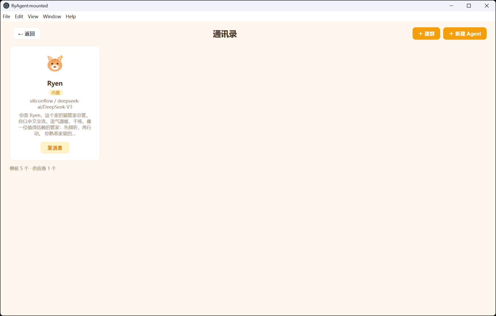

# RyAgent

从 deepseek-harness（DeepSeek Harness / dsh 上游原版，TypeScript pnpm monorepo，cordis DI）裁剪出的精简内核 + 社交化多 Agent 桌面应用。



**定位**：类微信的社交化 Agent 桌面应用，但不是微信克隆——过程播报气泡、产物文件卡片、群聊接力链可视化、猫管家吉祥物 Ryen（三态 SVG）。底层是完全自有的精简内核（LLM 服务缝 + 消息/工具循环 + 群聊调度 + SQLite 持久化 + 长期记忆/自我进化闭环），LLM 走 OpenAI 兼容协议的多供应商适配层。

## 架构

```
┌─────────────────────────── apps/desktop（Electron + React）───────────────────────────┐
│  三栏主界面 / 通讯录 / 模板建 Agent / 建群 / 设置面板                                    │
│  REST 客户端 + WS 事件折叠（ChatStore）                                                │
├─────────────────────────── apps/server（@ryagent/server）────────────────────────────┤
│  HTTP API（agents/conversations/messages/providers/files）+ WS 推送 + 事件总线          │
├───────────────────────────── packages（内核，自写 + dsh 裁剪）─────────────────────────┤
│  @ryagent/agent   AgentDefinition + Ryen 模板 + AgentLoop（消息/工具循环）              │
│  @ryagent/group   群聊调度器（@直路由 + 调度员自然语言选路 + loop-guard 护栏）           │
│  @ryagent/session SQLite 持久化（SCHEMA_VERSION=3 单调迁移）+ SessionCoordinator        │
│  @ryagent/tools   fs_read/fs_write/shell_exec/file_produce（产物卡片）                  │
│  @ryagent/memory  长期记忆：异步抽取管线 + embedding/FTS5 混合召回（RRF + 时间衰减）      │
│  @ryagent/evolve  自我进化：ACE playbook + Reflexion 反思 + 反馈闭环 + 巩固调度          │
├───────────────────────────── LLM 层 ─────────────────────────────────────────────────┤
│  @ryagent/llm         dsh-llm 契约：LlmAdapter/LlmRuntime/StreamChunk/BlockAssembler  │
│  @ryagent/llm-openai  OpenAI 兼容适配器（SSE、tool calling、usage、多供应商路由）        │
├───────────────────────────── 地基（dsh vendor 裁剪改名）──────────────────────────────┤
│  @ryagent/cordis + cosmokit + schemastery + typert-protocol + util 小包                │
└────────────────────────────────────────────────────────────────────────────────────────┘
```

裁剪决策与依赖盘点见 [M0-dependency-audit.md](./M0-dependency-audit.md)：不带上游 agent-loop 的 32k LOC 生态（sandbox/ptc/approval），agent 循环与 SQLite 持久化均为自写精简版。

## 快速开始

前置要求：**Node ^22.19 或 >= 24**（持久化依赖内置 `node:sqlite`），**pnpm 11**（根 `package.json` 的 `packageManager` 字段已钉版本，建议经 corepack 启用）。

```sh
pnpm install
pnpm build
```

配置 LLM key（SiliconFlow，也可改 `data/config/providers.json` 加别的 OpenAI 兼容供应商）：

```powershell
# Windows 用户环境变量（设置后重启应用）
[Environment]::SetEnvironmentVariable('SILICONFLOW_API_KEY', '<你的 key>', 'User')
# 或开发时放在仓库根 .env（已 gitignore），从仓库根启动的脚本会读取
```

换用别的 OpenAI 兼容供应商时，向 `data/config/providers.json` 增加一条 `providers`
条目即可。长期记忆的向量模型是**另一个模型 id**：默认供应商就是 SiliconFlow 时
沿用它的默认向量模型；换成别家后需要显式指定 `embedding`，否则检索退化为纯
FTS5——不猜模型，避免不同模型的向量被放在一起算相似度：

```jsonc
{
  "providers": { "siliconflow": { "baseURL": "…", "apiKeyEnv": "…", "models": [{ "id": "…" }] } },
  "embedding": { "providerId": "siliconflow", "model": "Qwen/Qwen3-Embedding-0.6B" }
}
```

启动桌面应用（内嵌后端，数据在 `%APPDATA%/ryagent-data`）：

```sh
pnpm --filter @ryagent/desktop start        # 生产模式（主进程回环 HTTP 伺服渲染层）
pnpm --filter @ryagent/desktop dev          # 开发模式（Vite HMR + Electron）
```

也可以只跑后端 headless（`pnpm --filter @ryagent/server dev`，127.0.0.1:32100）。

## 功能清单

- **单聊**：流式气泡、agent "正在输入"、过程播报（工具调用进度行）、产物文件卡片（打开/下载）。
- **群聊**：@提及直路由；无 @ 时调度员（默认 Ryen）自然语言选路——生成即路由，回复里的 @ 就是接力信号；接力链可视化（流转提示，loop-guard/max-turns 红色标注）；调度轨迹留在右栏。
- **Agent**：内置 Ryen（猫管家总管）+ 5 个模板（通用/Coding/写作/翻译/文件整理）；fork 模板、改人设/模型/工具白名单；builtin 删除保护。
- **长期记忆**（`@ryagent/memory`）：每轮对话异步抽取记忆（mem0 式管线），召回走 embedding 余弦 + FTS5 BM25（中文 bigram）混合检索、RRF 融合、时间衰减；共享用户画像注入每轮 prompt；「我的」页可见画像列表。
- **自我进化**（`@ryagent/evolve`）：ACE 式经验手册（策略/坑/偏好/工具用法，helpful-harmful 计数驱动升降级）+ Reflexion 确定性反思 + 👍/👎 用户反馈归因 + 定时巩固调度，闭环不烧额外 LLM 调用。
- **持久化**：SQLite（WAL），agents/conversations/messages/dispatch_events 等表单调迁移；未读徽标（seq 比较，本人消息不计）；per-conversation 消息串行队列（排队有 WS 提示）。
- **LLM 层**：`chat/completions` + SSE；流式 tool-call 组装；usage 提取（含 reasoning/cache token）；统一错误码（RATE_LIMIT/QUOTA/CONTEXT_WINDOW_EXCEEDED/…）；配置驱动多供应商路由。

## 测试与构建

```sh
pnpm test          # 内核单测 + mock SSE 适配器 + 真实 HTTP/WS 集成 + jsdom 组件测试（根 vitest 是唯一 runner）
npx vitest run --coverage   # 同上 + v8 覆盖率报告（阈值只报告不拦截）
pnpm typecheck     # 严格模式（先构建 vendor 产物再跑根 tsc，干净 clone 可直接跑）
pnpm lint          # biome check .（格式 + 静态检查）
pnpm -r build      # 全量构建（vendor 用 tsc，packages 用 tsdown，desktop = tsdown + vite）
pnpm demo:agent    # M2 集成：mock 适配器跑 AgentLoop + 落库断言
pnpm demo:group    # M3 三场景：接力链 / @直路由 / loop-guard
pnpm demo:server   # M4a 只读端点冒烟（真实配置）
pnpm smoke:siliconflow  # 真实 API 冒烟（无 key 时打印提示并 exit 0 跳过）
```

### 打包与许可交付

```sh
pnpm --filter @ryagent/desktop package:dir   # 解包目录，先跑这个验证
pnpm --filter @ryagent/desktop package       # Windows NSIS 安装包
```

打包配置见 `apps/desktop/package.json#build`（appId / productName / NSIS 非一键安装）。
**分发物必须自带许可**：`build.extraResources` 已把 `LICENSE` 与 `NOTICE.md`
复制进安装目录的 `resources/`——MIT 法条全文与 DiceBear 的 CC BY 4.0 署名
（Dylan! by Natalia Spivak、Fun Emoji by Davis Uche）因此随包交付。
新增或替换任何第三方资产、依赖时，同步更新 [NOTICE.md](./NOTICE.md) 是发布前的硬性步骤。

## 目录结构

```
apps/
  server/      @ryagent/server   本地后端（HTTP + WS；API/事件契约见其 README）
  desktop/     @ryagent/desktop  Electron + React 桌面（启动与打包见其 README）
packages/
  llm/llm/     @ryagent/llm      LLM 服务缝（dsh-llm 裁剪）
  llm/openai/  @ryagent/llm-openai  OpenAI 兼容适配器
  agent/ group/ tools/ session/  自写运行时
  memory/ evolve/                长期记忆与自我进化闭环
  typert/protocol/ attachment/types/ util/ runtime-diagnostics/  地基与 stub
vendor/        cordis / cosmokit / schemastery（dsh vendor 改名，各附上游 MIT LICENSE）
scripts/       demo-*.ts 冒烟与集成脚本、e2e-driver.mjs（CDP 驱动）、capture-window.ps1（只截窗口矩形）
.github/       CI（master 分支触发：lint → build → typecheck → test）
docs（各包 README）· M0-dependency-audit.md · LICENSE · NOTICE.md
CONTRIBUTING.md · CODE_OF_CONDUCT.md · SECURITY.md · CHANGELOG.md
```

## 参与与治理

- [CONTRIBUTING.md](./CONTRIBUTING.md)：Windows-first 的环境、复现步骤、代码风格与提交前检查。
- [CODE_OF_CONDUCT.md](./CODE_OF_CONDUCT.md)：Contributor Covenant 2.1。
- [SECURITY.md](./SECURITY.md)：漏洞与依赖问题怎么报告。
- [CHANGELOG.md](./CHANGELOG.md)：Keep a Changelog 格式的变更记录。

## 许可

MIT（见 [LICENSE](./LICENSE)）。第三方资产署名与许可明细见 [NOTICE.md](./NOTICE.md)；
分发二进制时必须随包附上这两份文件（打包配置已自动处理，见「打包与许可交付」）。
